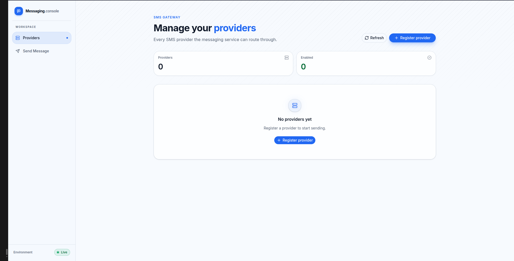
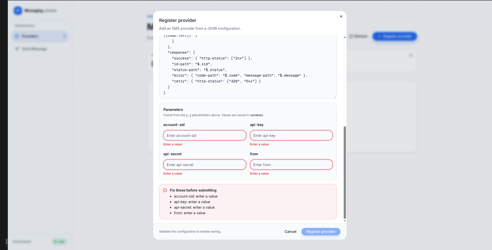
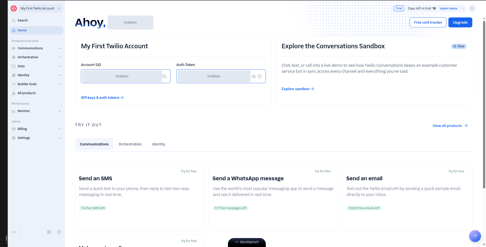
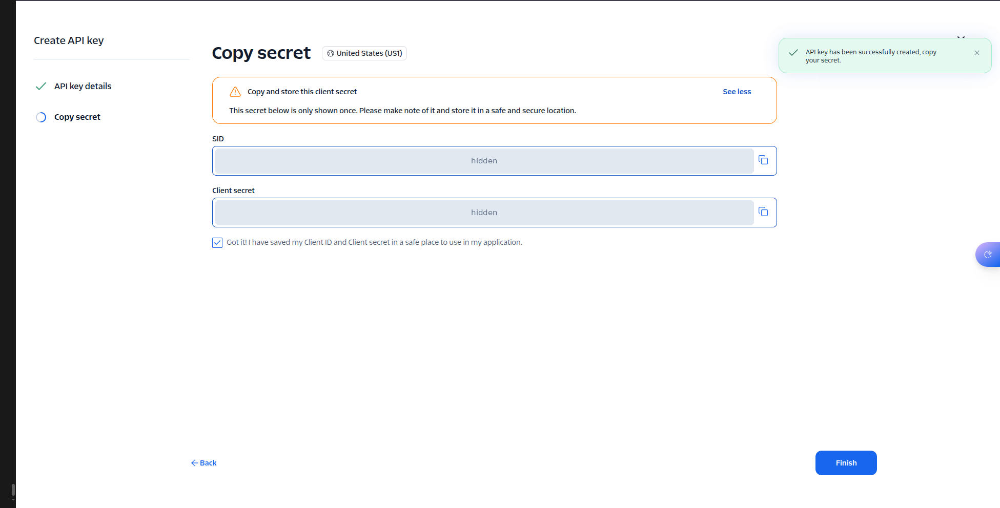
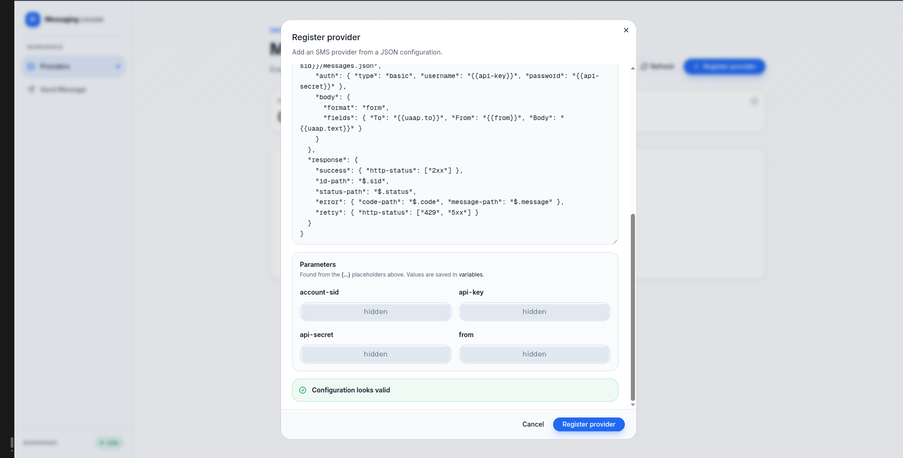
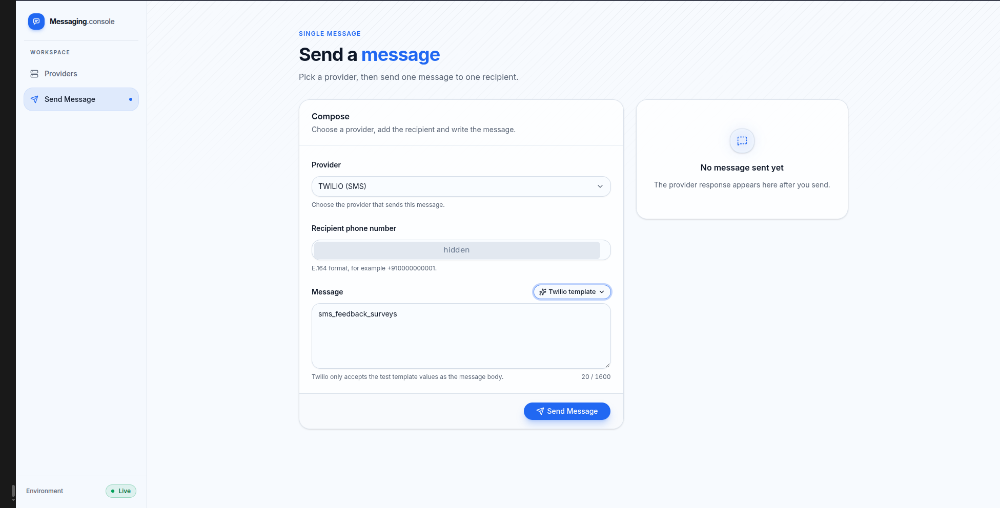
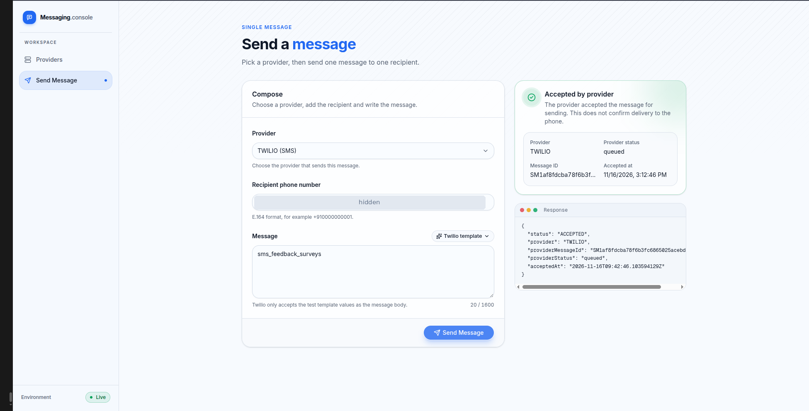

# Set up Twilio SMS

You register Twilio SMS in the **Messaging Console**. It asks for four values; each step below
shows where to find that value in your Twilio account.

## Part 1: Start in the Messaging Console

### Step 1. Open Register provider

Open **http://localhost:5173**, go to **Providers** and click **Register provider**.

### Step 2. Paste the template

Open [twilio-sms.json](twilio-sms.json), copy all of it, and paste it into the box. Four boxes
appear below it: `account-sid`, `api-key`, `api-secret` and `from`.

## Part 2: Fill in each box from Twilio

Keep the Messaging Console open. In another browser tab, sign in at
**https://console.twilio.com**.

### Step 3. `account-sid`

In Twilio, on the **Home** page, copy the **Account SID** (starts with `AC`). Paste it into the
`account-sid` box.

### Step 4. `api-key` and `api-secret`

In Twilio, on the **Home** page, click **API keys & auth tokens**. Stay on the **API keys** tab and
click **Create API key**.

Enter any **API key name** (for example `messaging-console`), set **Key type** to **Main**, and
click **Next**.

Copy both values now. **The Client secret is shown only once.**

- **SID** (starts with `SK`): paste it into the `api-key` box.
- **Client secret**: paste it into the `api-secret` box.

Tick **Got it!** and click **Finish**.

### Step 5. `from`

In Twilio, go back to **Home**. Under **Try it out**, open **Send an SMS**. Copy the **From**
number with the `+` and the country code, no spaces. Paste it into the `from` box.

### Step 6. Register

Back in the Messaging Console, click **Validate**. When it says **Configuration looks valid**,
click **Register provider**.

The provider now shows in the list as **TWILIO**, **Enabled**.

## Part 3: Send a test SMS

### Step 7. Send

Open **Send Message**:

1. **Provider:** choose **TWILIO (SMS)**.
2. **Recipient phone number:** with `+` and the country code, e.g. `+919876543210`.
3. **Message:** on a Twilio trial account, click **Twilio template** and pick one (e.g.
   `sms_feedback_surveys`). A trial only accepts these test messages.
4. Click **Send Message**.

A green **Accepted by provider** card means Twilio took the message.

