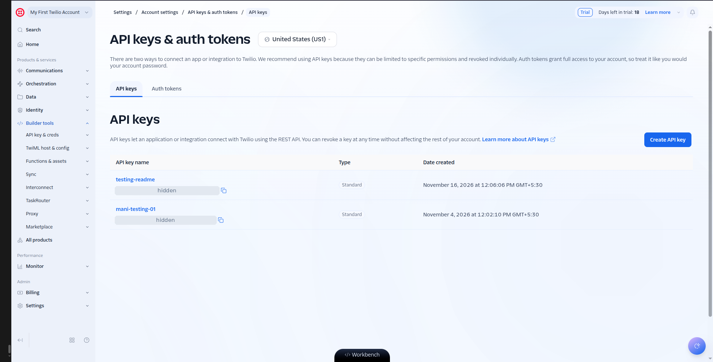
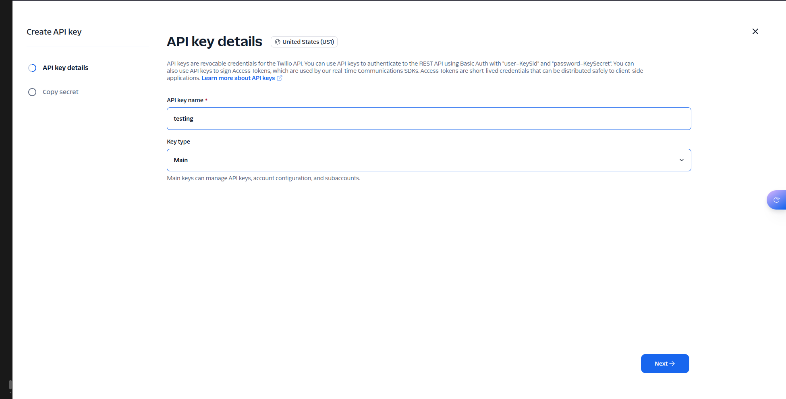
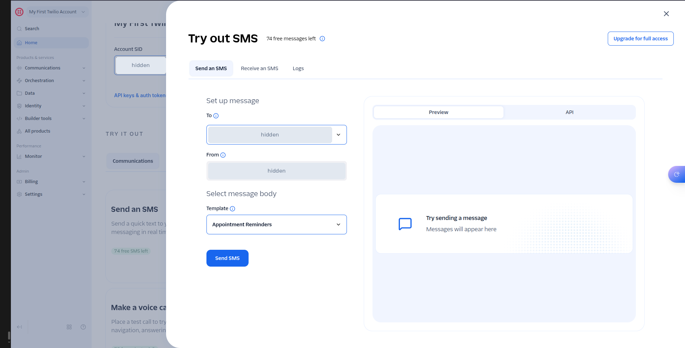
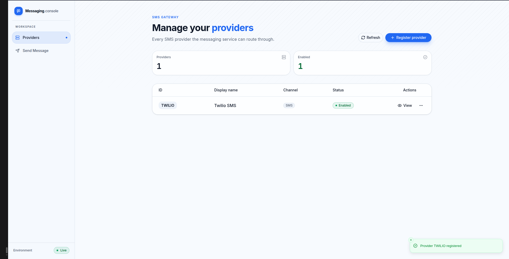

# Set up Twilio SMS

Three parts: copy four values from Twilio, register them in the Messaging Console, send a test SMS.

| Value | Where you find it in Twilio | Looks like |
|---|---|---|
| `account-sid` | Home page, **Account SID** | `AC...` (34 characters) |
| `api-key` | New API key, **SID** | `SK...` (34 characters) |
| `api-secret` | New API key, **Client secret** (shown only once) | 32 characters |
| `from` | **Try out SMS**, **From** | `+15551234567` |

Keep these values private. Anyone who has them can send messages on your account.

## Part 1: Get your values from Twilio

Sign in at **https://console.twilio.com**.

### Step 1. Copy the Account SID

On the **Home** page, copy the **Account SID** (click the copy icon next to it). This is your
`account-sid`.

Then click **API keys & auth tokens** below it.

### Step 2. Create an API key

On **API keys & auth tokens**, stay on the **API keys** tab and click **Create API key**.

Enter any **API key name** (for example `messaging-console`), set **Key type** to **Main**, and
click **Next**.

### Step 3. Copy the SID and the Client secret

Copy both values now. **The Client secret is shown only once.** If you lose it, create a new key.

- **SID** is your `api-key`
- **Client secret** is your `api-secret`

Tick **Got it!** and click **Finish**.

### Step 4. Copy your Twilio phone number

Go back to **Home**. Under **Try it out**, open **Send an SMS**. The **From** number is your
`from`. Copy it with the `+` and the country code, no spaces.

## Part 2: Register the provider in the Messaging Console

### Step 5. Open Register provider

Open **http://localhost:5173**, go to **Providers** and click **Register provider**.

### Step 6. Paste the template

Open [twilio-sms.json](twilio-sms.json), copy all of it, and paste it into the box. Four boxes
appear below it: `account-sid`, `api-key`, `api-secret` and `from`.

### Step 7. Fill in your values and register

Paste the four values from Part 1. Click **Validate**. When it says **Configuration looks valid**,
click **Register provider**.

The provider now shows in the list as **TWILIO**, **Enabled**.

## Part 3: Send a test SMS

### Step 8. Send

Open **Send Message**:

1. **Provider:** choose **TWILIO (SMS)**.
2. **Recipient phone number:** with `+` and the country code, e.g. `+919876543210`.
3. **Message:** on a Twilio trial account, click **Twilio template** and pick one (e.g.
   `sms_feedback_surveys`). A trial only accepts these test messages.
4. Click **Send Message**.

A green **Accepted by provider** card means Twilio took the message.

