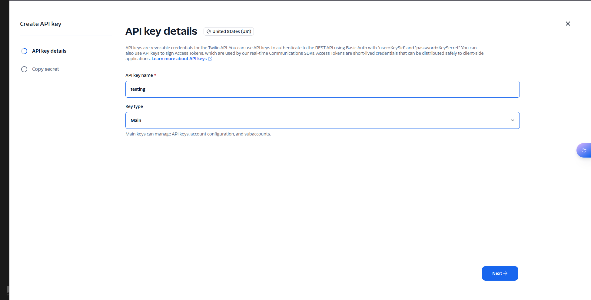
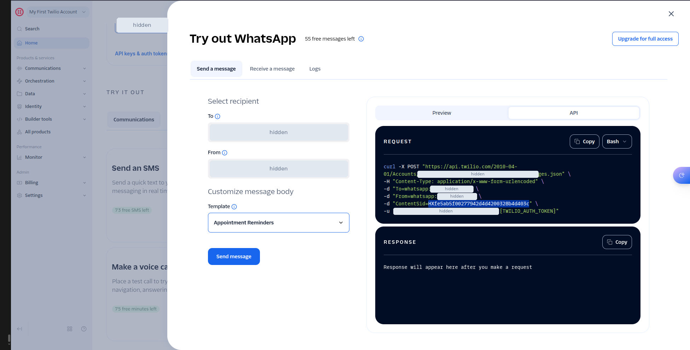
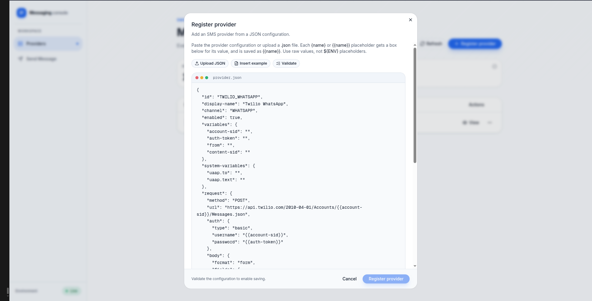
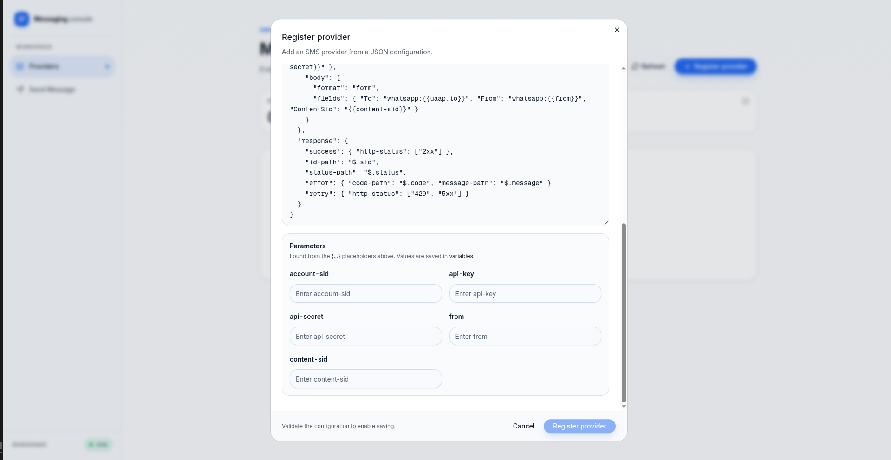
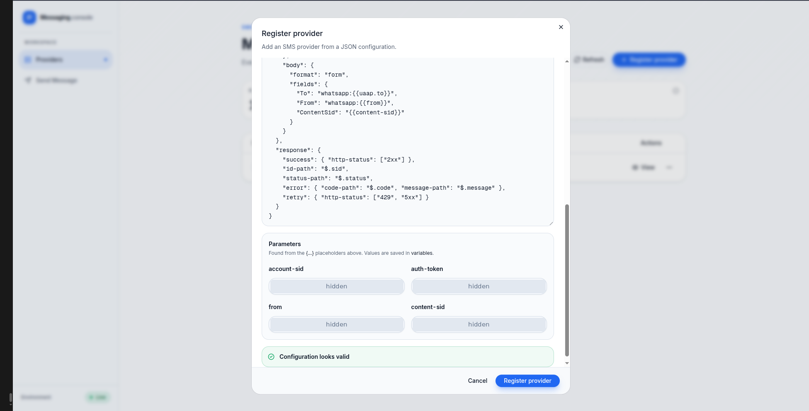
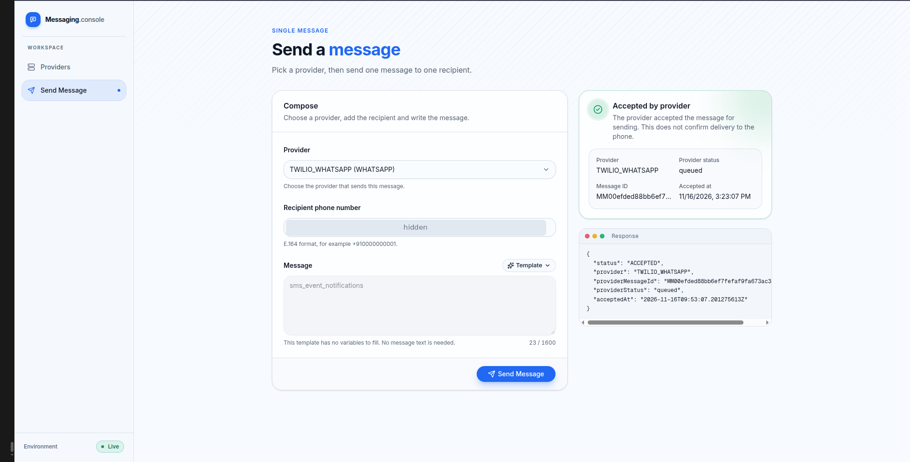

# Set up Twilio WhatsApp

Three parts: copy five values from Twilio, register them in the Messaging Console, send a test
WhatsApp message.

WhatsApp signs in to Twilio the same way as SMS: with an **API key** and its **Client secret**. If
you already set up SMS, use the same API key here.

| Value | Where you find it in Twilio | Looks like |
|---|---|---|
| `account-sid` | Home page, **Account SID** | `AC...` (34 characters) |
| `api-key` | API key, **SID** | `SK...` (34 characters) |
| `api-secret` | API key, **Client secret** (shown only once) | 32 characters |
| `from` | **Try out WhatsApp > Send a message**, **From** | `+15551234567` |
| `content-sid` | **Try out WhatsApp > Send a message > API**, `ContentSid=` | `HX...` (34 characters) |

Keep `api-key` and `api-secret` private: anyone who has them can send messages on your account.
`content-sid` is not a secret. It only names the message template to send.

## Part 1: Get your values from Twilio

Sign in at **https://console.twilio.com**.

### Step 1. Copy the Account SID

On the **Home** page, copy the **Account SID** (`account-sid`) with the copy icon next to it.

### Step 2. Get an API key and its Client secret

**Already set up SMS?** Use the same API key: its **SID** is your `api-key` and its **Client
secret** is your `api-secret`. Go to Step 3.

Otherwise, on the Home page click **API keys & auth tokens**, then **Create API key**. Enter any
name (for example `messaging-console`), set **Key type** to **Main**, and click **Next**.

Copy both values now. **The Client secret is shown only once.**

- **SID** is your `api-key`
- **Client secret** is your `api-secret`

### Step 3. Connect your phone to the WhatsApp test environment

On the same page, under **Try it out**, open **Send a WhatsApp message**.

1. **Select your tester:** choose your own phone number.
2. **Link your device:** open WhatsApp on that phone and send the code shown (for example
   `join twilio-trial`) to the number shown. Or scan the QR code.

This is needed once per phone on a Twilio trial. Only phones that did it can receive your
messages.

### Step 4. Copy the From number

After your phone is connected, the **Send a message** tab opens. The **From** number is your
`from`. Copy it with the `+` and the country code, no spaces. Don't add `whatsapp:`; the app adds
it.

Under **Template**, choose the message you want to send (for example **Appointment Reminders**).

### Step 5. Copy the ContentSid

Click the **API** tab on the right. In the request, find `ContentSid=` and copy the value after it
(starts with `HX`, highlighted below). This is your `content-sid`. It is not a secret: it only
names the template.

The `ContentSid` belongs to the template you chose in Step 4. Choose another template and it
changes.

## Part 2: Register the provider in the Messaging Console

### Step 6. Paste the template

Open **http://localhost:5173**, go to **Providers** and click **Register provider**. Open
[twilio-whatsapp.json](twilio-whatsapp.json), copy all of it, and paste it into the box.

Five boxes appear below it: `account-sid`, `api-key`, `api-secret`, `from` and `content-sid`.

### Step 7. Fill in your values and register

Paste the five values from Part 1. Click **Validate**. When it says **Configuration looks valid**,
click **Register provider**.

The provider now shows in the list as **TWILIO_WHATSAPP**, channel **WHATSAPP**, **Enabled**.

## Part 3: Send a test WhatsApp message

### Step 8. Send

Open **Send Message**:

1. **Provider:** choose **TWILIO_WHATSAPP (WHATSAPP)**.

   

2. **Recipient phone number:** the phone you connected in Step 3, with `+` and the country code,
   e.g. `+919876543210`.
3. **Message:** nothing to type. The template's own text is sent.
4. Click **Send Message**.

A green **Accepted by provider** card means Twilio took the message. It arrives in WhatsApp on that
phone.

