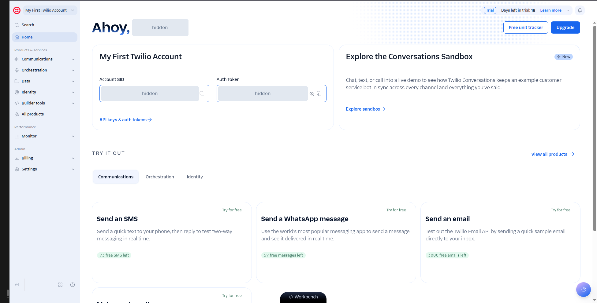
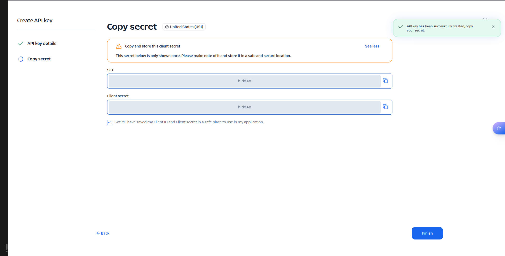

# Set up Twilio WhatsApp

You register Twilio WhatsApp in the **Messaging Console**. It asks for five values; each step
below shows where to find that value in your Twilio account.

## Part 1: Start in the Messaging Console

### Step 1. Open Register provider

Open **http://localhost:5173**, go to **Providers** and click **Register provider**.

### Step 2. Paste the template

Open [twilio-whatsapp.json](twilio-whatsapp.json), copy all of it, and paste it into the box.
Five boxes appear below it: `account-sid`, `api-key`, `api-secret`, `from` and `content-sid`.

## Part 2: Fill in each box from Twilio

Keep the Messaging Console open. In another browser tab, sign in at
**https://console.twilio.com**.

### Step 3. `account-sid`

In Twilio, on the **Home** page, copy the **Account SID** (starts with `AC`). Paste it into the
`account-sid` box.

### Step 4. `api-key` and `api-secret`

In Twilio, on the **Home** page, click **API keys & auth tokens**, then **Create API key**. Enter
any name (for example `messaging-console`), set **Key type** to **Main**, and click **Next**.

Copy both values now. **The Client secret is shown only once.**

- **SID** (starts with `SK`): paste it into the `api-key` box.
- **Client secret**: paste it into the `api-secret` box.

### Step 5. Connect your phone to WhatsApp testing

You need this before Twilio shows the `from` number, and before your phone can receive messages.

In Twilio, go back to **Home**. Under **Try it out**, open **Send a WhatsApp message**.

1. **Select your tester:** choose your own phone number.
2. **Link your device:** open WhatsApp on that phone and send the code shown (for example
   `join twilio-trial`) to the number shown. Or scan the QR code.

### Step 6. `from`

After your phone is connected, the **Send a message** tab opens. Copy the **From** number with the
`+` and the country code, no spaces (don't add `whatsapp:`). Paste it into the `from` box.

Under **Template**, choose the message you want to send (for example **Appointment Reminders**).

### Step 7. `content-sid`

Click the **API** tab on the right. In the request, copy the value after `ContentSid=` (starts with
`HX`, highlighted below). Paste it into the `content-sid` box.

It belongs to the template you chose in Step 6. Choose another template and it changes.

### Step 8. Register

Back in the Messaging Console, click **Validate**. When it says **Configuration looks valid**,
click **Register provider**.

The provider now shows in the list as **TWILIO_WHATSAPP**, channel **WHATSAPP**, **Enabled**.

## Part 3: Send a test WhatsApp message

### Step 9. Send

Open **Send Message**:

1. **Provider:** choose **TWILIO_WHATSAPP (WHATSAPP)**.

   

2. **Recipient phone number:** the phone you connected in Step 5, with `+` and the country code,
   e.g. `+919876543210`.
3. **Message:** nothing to type. The template's own text is sent.
4. Click **Send Message**.

A green **Accepted by provider** card means Twilio took the message. It arrives in WhatsApp on that
phone.

